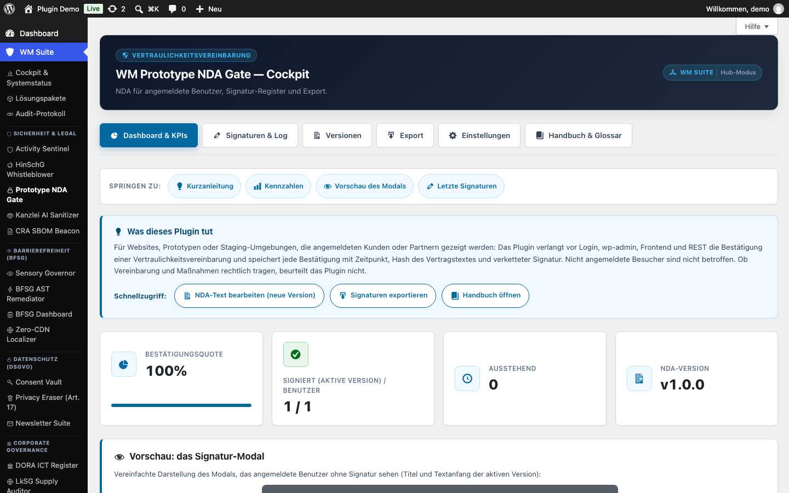
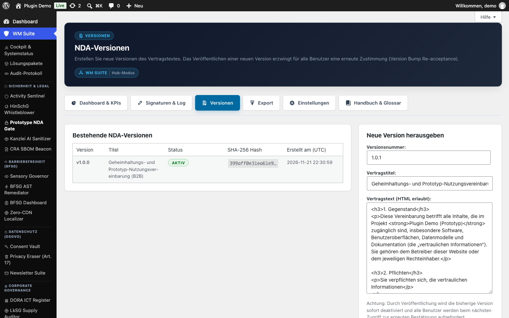
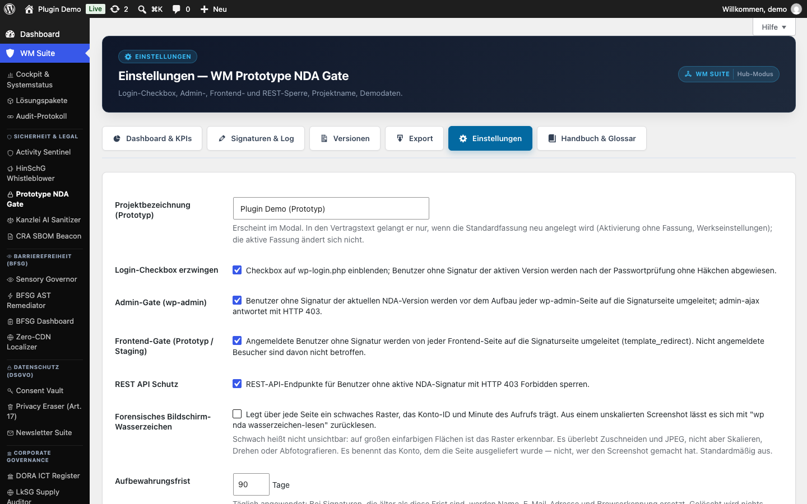
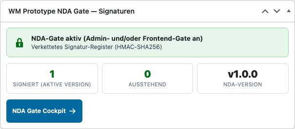

# WM Prototype NDA Gate (Deutsche Dokumentation)

<p align="center">
  <a href="README.md"></a>
  <a href="README.de.md"></a>
  <a href="README.es.md"></a>
</p>

> **Verlangt von angemeldeten Benutzern die Bestätigung einer Vertraulichkeitsvereinbarung, bevor sie wp-login, wp-admin, das Frontend oder die REST-API nutzen, und hält jede Bestätigung in einem HMAC-verketteten Register mit CSV- und JSON-Export fest — eine rechtliche Bewertung der Vereinbarung trifft es nicht**  
> **Plugin-Seite:** [https://arnoldwender.com/wordpress-plugins/wm-prototype-nda-gate/](https://arnoldwender.com/wordpress-plugins/wm-prototype-nda-gate/)  
> **Mit einem agentischen Workflow entwickelt:** entstanden mit KI-Coding-Agenten. Prüfen und testen Sie es wie jeden fremden Code, bevor Sie es produktiv einsetzen.  
> **Support & Haftung:** Kein Support (Zero Support) — reproduzierbare Bugs ausschließlich über [GitHub Issues](https://github.com/arnoldwender/wm-wp-prototype-nda-gate/issues) · kein privater Support · OHNE GEWÄHR („AS IS“) / keine Haftung ([SUPPORT.md](SUPPORT.md))

> Diese Datei beschreibt, was das Plugin tatsächlich ausliefert: die WP-CLI-Befehle `wp nda status|list|verify|demodaten|retention|wasserzeichen-lesen|wasserzeichen-probe`, die REST-Routen `/accept`, `/verify`, `/register-integrity` und `/active-terms`, die Tabellen `wp_wm_nda_terms` und `wp_wm_nda_acceptances`, die Action `wm_nda_accepted`, Block Bindings ab WP 6.5 (`wm-nda/status`) sowie das GenerateBlocks-Dynamic-Tag (`{{wm_nda_status}}`). Frühere Fassungen nannten nicht ausgelieferte Bestandteile (keinen Shortcode, keinen PDF-Export, kein GoBD-Journal) und trafen rechtliche Aussagen, die Software nicht treffen kann; Code und Dokumentation wurden gemeinsam geprüft und abgeglichen ([CHANGELOG.md](CHANGELOG.md)).

---

## Live-Vorschau

!WM Prototype NDA Gate Banner

| Cockpit | NDA-Versionen | Einstellungen | Dashboard-Widget |
|---|---|---|---|
|  |  |  |  |

---

## Was das Plugin leistet

1. **Login-Checkbox:** Auf `wp-login.php` eine Checkbox (24 × 24 px) mit dem Zustimmungstext und einer Schaltfläche, die den vollständigen Text öffnet. Die Prüfung läuft auf `authenticate` mit Priorität 99, nachdem WordPress das Passwort geprüft hat: Wer die aktive Fassung noch nicht bestätigt und nicht angehakt hat, wird mit einer Anleitung abgewiesen, und ein Audit-Ereignis `nda_bypass_attempt` wird geschrieben; das Häkchen speichert die Bestätigung, und lässt sie sich nicht speichern, wird die Anmeldung abgewiesen. Wer bereits bestätigt hat, meldet sich ohne Häkchen an. Anmeldungen per Anwendungspasswort werden nicht gefragt. Nur `wp-login.php` zeigt die Checkbox: Anmeldungen über `wp_login_form()`, Theme- oder Shop-Formulare und XML-RPC weisen Benutzer ohne Bestätigung mit derselben Anleitung ab, ohne sie anzubieten. Option `wm_nda_require_login_checkbox`.
2. **Admin- und Frontend-Gate:** Für angemeldete Benutzer ohne Bestätigung der aktiven Fassung leitet `admin_init` (Priorität 1) jede wp-admin-Anfrage auf `admin.php?page=wm-nda-gate` um, eine Seite ohne Menüeintrag (Capability `read`), deren Vollbild-Modal das Admin-Menü und die Hinweise überdeckt, die WordPress darunter weiterhin ausgibt; `admin-ajax.php` antwortet mit HTTP 403 `wm_nda_required`. `template_redirect` (Priorität 0) schickt Frontend-Anfragen auf dieselbe Seite. Die angefragte Adresse wird kodiert in `redirect_to` mitgegeben; nach der Bestätigung im Modal geht es dorthin weiter (nur gleicher Host). Optionen `wm_nda_enforce_admin_gate`, `wm_nda_enforce_frontend_gate`; Filter `wm_nda_gate_url` (eine Frontend-Seite, auf die er zeigt, wird nicht auf sich selbst umgeleitet, muss das Modal ausgeben und seine Assets laden und behält den Benutzer nach der Bestätigung). Nicht angemeldete Besucher, WP-CLI und Cron sind nicht betroffen.
3. **REST-Sperre:** `rest_pre_dispatch` antwortet angemeldeten Benutzern ohne Bestätigung mit HTTP 403 `rest_forbidden` („Bitte bestätigen Sie zuerst die aktuelle Vertraulichkeitsvereinbarung (NDA).“), außer für Routen unter `/wm-nda/v1/`, `/wp/v2/users/me` und `/wm-hub/v1/` (Filter `wm_nda_whitelisted_routes`). Option `wm_nda_enforce_rest_api`.
4. **Register:** Jede Bestätigung speichert User-ID, E-Mail, Anzeigename, den SHA-256 des Vertragstextes, einen HMAC der IP-Adresse mit täglichem Salt, den User-Agent, den Zeitpunkt (UTC), die vorherige Signatur und die eigene Signatur (HMAC-SHA256 über vorherige Signatur, User-ID, Versions-ID, Text-Hash, Zeitpunkt und IP-Hash, Schlüssel `AUTH_KEY` oder `wp_salt( 'auth' )`). Schreibvorgänge laufen unter einer MySQL-Namenssperre, gleichzeitige Bestätigungen verzweigen die Kette also nicht. Die neueste Signatur und die Zeilenzahl stehen in `wm_nda_register_tip`, versiegelt mit einem HMAC unter demselben Schlüssel. Als bestätigt gilt nur, wer eine Zeile mit gültiger Signatur hat. `WM_NDA_Database::verify_register()` rechnet jede Zeile nach und meldet eine geänderte, entfernte, eingeschleuste oder abgeschnittene Bestätigung sowie eine fehlende, unversiegelte oder umgeschriebene Kettenspitze, solange der Schlüssel nicht bekannt ist; eine vorher kopierte ältere versiegelte Spitze, die zurückgespielt wird, fällt nicht auf. Passt keine gespeicherte Signatur zum Schlüssel (neuer `AUTH_KEY`, Datenbank aus einer anderen Installation), sagt die Prüfung das. `wp nda verify`, `GET /wp-json/wm-nda/v1/register-integrity` (409 bei Fehler) und die Signaturseite zeigen das Ergebnis. Audit-Ereignisse gehen an WM Activity Sentinel, wenn es aktiv ist, sonst ins PHP-Fehlerprotokoll.
5. **Click-Wrap-Nachweis:** Mit der Bestätigung meldet der Browser, was er beobachtet hat, während die Vereinbarung auf dem Bildschirm stand: Eingabegerät (Maus, Stift, Touch, Tastatur), wie lange der Dialog offen war, wie lange zwischen Häkchen und Bestätigung lag, wie weit der Text durchgeblättert wurde, wie viele Messpunkte der Zeiger lieferte und welchen Weg er zurücklegte, den höchsten Druckwert, das Sichtfenster und den Zeitzonenversatz des Geräts. Zehn ganze Zahlen und zwei Aufzählungen, sonst nichts — keine Koordinaten, keine Zeitreihen. Was außerhalb seines Bereichs liegt, wird verworfen, ein Nachweis über 2 048 Byte ganz, und ein unlesbarer Nachweis weist die Bestätigung nie ab. Was bleibt, ist versiegelt: Der SHA-256 des gespeicherten Nachweises wird an die signierten Daten der Zeile angehängt, ein nachträgliches Ändern, Leeren oder Erfinden bricht die Kette ab dort. Er stammt vom Browser: Er zeigt, dass der Dialog bedient wurde, nicht von wem; eine Maus hat keinen Drucksensor, und die Oberfläche nennt ihren Festwert 0,5 beim Namen. Bestätigungen vor dem 16.09.2026 und Browser ohne JavaScript tragen keinen, und diese Zeilen verifizieren unverändert weiter.
6. **Forensisches Bildschirm-Wasserzeichen:** Standardmäßig aus (`wm_nda_watermark`). Eingeschaltet trägt jede Seite, die ein angemeldeter Unterzeichner sieht, ein schwaches Raster aus 16-px-Zellen: achtzig davon bilden einen Block aus Synchronisationswort, Konto-ID, Minute der Auslieferung und einem 20-Bit-HMAC unter `AUTH_KEY`; der Block wiederholt sich über das Sichtfenster, jeder zweite invertiert. `wp nda wasserzeichen-lesen <datei>` liest ihn aus einem Screenshot zurück und benennt das Konto — oder meldet „nicht gefunden“, denn der HMAC entscheidet und rät nie. **Gemessen am 2026-09-16** (`tests/test-suite.php`, Gruppe 13, synthetische Screenshots einer Textseite): lesbar aus 1440 × 900 und 2880 × 1800, von dunklen Seiten, von Seiten mit Hero-Bild in der oberen Hälfte, aus Ausschnitten bis herunter zu 800 × 640 (auch unausgerichtet) und aus JPEG bis Qualität 40 — und, mit einem echten Browser gegen die lokale WordPress-Installation-Demo gemessen, aus dem Screenshot einer tatsächlichen WordPress-Seite. **Nicht** lesbar aus einem skalierten Screenshot, aus einem Ausschnitt mit nur einem Block oder von stark fotografischem Untergrund — dort lautet die Antwort „nicht gefunden“. Es benennt das Konto, dem die Seite ausgeliefert wurde, nicht die Person, die den Screenshot gemacht hat, und es kostet Kontrast: Grau #6e6e6e auf Weiß misst 5,10:1 und unter dem Raster 4,49:1, Text knapp über der WCAG-Schwelle fällt also darunter.
7. **Versionen:** Eine neue Fassung wird gespeichert und deaktiviert erst dann die vorherige; alle Benutzer müssen erneut bestätigen. Eine Versionsnummer über 50 oder ein Titel über 255 Zeichen wird abgewiesen, die bisherige Fassung bleibt aktiv. Der Standardtext ist ein deutsches Muster ohne juristische Prüfung: Er nennt keine Vorschriften und keinen Anbieter und führt auf, was das Register je Bestätigung speichert.
8. **Backend:** Menü *WM NDA Gate* (Position 26) mit Cockpit (Bestätigungsquote, signierte und ausstehende Benutzer, Version, letzte Signaturen, Modal-Vorschau), Signaturen mit Prüfergebnis, Versionen, Export (CSV mit Schutz vor Formel-Injektion, JSON mit Registerprüfung und einer Prüfsumme, deren Rechenweg in der Datei steht; beide mit allen Bestätigungen), Einstellungen mit Demodaten und Werkseinstellungen, Handbuch; Dashboard-Widget. Deutsche Oberfläche auf den Admin-Stylesheets der WM-Suite-Familie.
9. **REST und WP-CLI:** `POST /wp-json/wm-nda/v1/accept` (angemeldet, 10 pro Minute je IP), `GET /verify` (eigener Status; andere nur für Administratoren; 60 pro Minute je IP über `check_public_nda_access`, Filter `wm_nda_rest_rate_limit`), `GET /register-integrity` (Administratoren), `GET /active-terms` (öffentlich, 60 pro Minute je IP). `wp nda status`, `wp nda list [--limit]`, `wp nda verify` (Fehler-Exit bei gebrochenem Register), `wp nda demodaten --import|--delete|--reset [--yes]`, `wp nda retention [--dry-run]`, `wp nda wasserzeichen-lesen <datei> [--porcelain]`, `wp nda wasserzeichen-probe [--user] [--datei] [--breite] [--hoehe]`.
10. **WordPress-Datenschutzwerkzeuge:** Export und Löschung von Bestätigungen nach E-Mail, passend zur beim Signieren gespeicherten Adresse und zum Konto, das die Adresse heute trägt; die Löschung pseudonymisiert Name, E-Mail und User-Agent, meldet, was bleibt (User-ID, Signatur, Zeitpunkt, Version, IP-Hash — alles Teil der signierten Daten), und löscht die Metadaten der letzten Bestätigung am Konto.
11. **WM Suite Hub Spoke:** Health `ERROR` ohne die Tabellen des Plugins oder wenn das Register nicht verifiziert, `NEEDS_CONFIG` ohne aktive Fassung, `DEGRADED`, wenn alle Gates aus sind, der Schlüssel aus der Datenbank kommt oder Zeilen aus der Zeit vor der Verkettung vorliegen, sonst `HEALTHY`; Telemetrie mit Tabellen, Version, Signaturen, Registerzustand, Schlüsselquelle, Audit-Ziel und Gate-Optionen; Aktionen `self_test` und `purge_cache`.
12. **Block Bindings und GenerateBlocks:** Registriert die Block-Bindings-Quelle `wm-nda/status` (`field`: `label`, `state`, `active_version`) ab WordPress 6.5 sowie das GenerateBlocks-Dynamic-Tag `{{wm_nda_status}}` (`key`: `label`, `state`, `active_version`), gefiltert über `wm_nda_status_value`.

### Nicht enthalten

Kein Gate für nicht angemeldete Besucher (eine Website, die für sie geschlossen bleiben soll, braucht eine eigene Login-Pflicht); kein Shortcode oder eigener Block (der Status steht über Block Bindings `wm-nda/status` und GenerateBlocks `{{wm_nda_status}}` bereit); kein PDF-Export; keine Löschung von Bestätigungen nach der Aufbewahrungsfrist — seit dem 2026-09-17 pseudonymisiert ein täglicher Lauf Name, E-Mail und User-Agent älterer Bestätigungen und lässt die Zeile stehen (`wp nda retention`, Einzelheiten in [README.md](README.md#what-the-retention-pass-does)); keine E-Mail-Benachrichtigungen, Ausnahme-Rollen oder IP-Freigaben; keine elektronische Signatur im Sinne von eIDAS, nur ein protokollierter Klick; keine biometrische Identifizierung — der Click-Wrap-Nachweis zählt, wie der Dialog bedient wurde, und kann keine Person von einer anderen unterscheiden; keine Bewertung, ob Vereinbarung oder Maßnahmen GeschGehG, UrhG oder DSGVO genügen.

---

## Schnellstart

1. Plugin installieren und aktivieren (WordPress 6.4+, PHP 8.2+). Die Aktivierung legt die Tabellen und Version 1.0.0 der Standardvereinbarung an.
2. Unter **WM NDA Gate › Versionen** den Standardtext lesen und eine eigene Fassung veröffentlichen; vor dem Einsatz rechtlich prüfen lassen.
3. Unter **Einstellungen** die vier Gates prüfen und den Projektnamen setzen.
4. Mit einem Testkonto anmelden, das noch nicht bestätigt hat: ohne Häkchen wird die Anmeldung abgewiesen; mit Häkchen erscheint die Bestätigung unter **Signaturen & Log**.
5. `wp nda verify` ausführen oder **Signaturen & Log** öffnen, um die Registerprüfung zu sehen.

Klassen, Routen, Hooks, Optionen und bekannte Abweichungen: **[README.md](README.md)** (Referenz), **[DEVELOPERS.md](DEVELOPERS.md)** und [docs/DEVELOPER-GUIDE.md](docs/DEVELOPER-GUIDE.md).

```bash
php tests/test-suite.php        # Register, Gates, Exporte, Datenschutzwerkzeuge, Adapter, Demodaten, Tokens, Kataloge, Dokumente
bash tests/run-mutations.sh     # jede Korrektur einmal zurückgenommen; die Suite muss rot werden
wp eval-file wp-content/plugins/wm-prototype-nda-gate/tests/wp-runtime-nda.php --user=1   # in WordPress; schreibt nichts
tests/runtime/verify-gate-http.sh   # 19 HTTP-Prüfungen gegen ein lokales WordPress (legt einen Testbenutzer an und löscht ihn)
```

### Bekannte Einschränkungen

- Der Standard-Vertragstext ist ein Muster ohne juristische Prüfung. Seit 1.3.3 nennen er, der Hinweis im Modal, die Checkbox und die Bestätigungsschaltfläche keine Vorschriften und behaupten keine Verbindlichkeit; vor dem echten Einsatz eine eigene, geprüfte Fassung unter **Versionen** veröffentlichen.
- Demodaten lassen sich nur in ein Register ohne echte Signaturen importieren und nur löschen, solange keine echte Signatur mit ihnen verkettet ist; die Werkseinstellungen löschen alles.
- `tests/test-nda-interception.php` und `test-register-integrity.php` leeren das Register, `test-nda-privacy-tools.php` schreibt und löscht eine Testzeile; nur in einer Wegwerf-Instanz von WordPress ausführen.
- Die Prüfung liest bei jedem Aufruf alle Zeilen; Signaturseite und Hub führen sie bei jeder Ansicht aus.
- Ein neuer `AUTH_KEY` oder eine aus einer anderen Installation kopierte Datenbank macht alle gespeicherten Signaturen unprüfbar; nichts signiert sie neu, und die Benutzer bestätigen erneut.
- Zeilen aus der Zeit vor der Verkettung (vor dem 2026-08-27) gelten nicht mehr als Bestätigung.
- Unter SQLite (WordPress Playground, wp-now) werden Schreibvorgänge im Register nicht serialisiert.
- Die Signaturseite überdeckt das Admin-Menü nur; ihr HTML enthält es weiterhin, ebenso Hinweise anderer Plugins.
- Die Kennzahl „Ausstehend“ zählt jeden registrierten Benutzer ohne Bestätigung, auch solche, die sich nie anmelden.
- Das Bildschirm-Wasserzeichen ist schwach, nicht unsichtbar: auf großen einfarbigen Flächen ist das Raster erkennbar. Es übersteht Zuschneiden und JPEG, nicht aber Skalieren, Drehen oder Abfotografieren, und es kostet den oben gemessenen Kontrast. Standardmäßig ist es aus.
- Der Click-Wrap-Nachweis ist das, was der Browser gemeldet hat. Nachträglich ändern lässt er sich nicht, ohne die Kette zu brechen; ob er beim Senden stimmte, prüft nichts.

---

## Daten und Grenzen

- **Was das Plugin feststellt:** dass ein angemeldetes Konto zu einem bestimmten Zeitpunkt eine bestimmte Textfassung angehakt oder bestätigt hat, gespeichert mit einer verketteten Signatur, die spätere Änderungen ohne den Schlüssel sichtbar macht. Es entscheidet nicht, ob die Vereinbarung wirksam ist, ob die Maßnahmen im Sinne von § 2 GeschGehG angemessen sind oder welche Beweiskraft das Register hat.
- **Ausgehende Anfragen:** keine.
- **Personenbezogene Daten:** je Bestätigung User-ID, E-Mail, Anzeigename, User-Agent, der Click-Wrap-Nachweis (Eingabegerät, Dauern, Zeigerweg, Sichtfenster, Zeitzonenversatz — die letzten beiden beschreiben das benutzte Gerät), Zeitpunkt und ein HMAC der IP-Adresse mit täglichem Salt, in zwei Tabellen der eigenen Datenbank; die WordPress-Datenschutzwerkzeuge exportieren und pseudonymisieren sie, und der tägliche Aufbewahrungslauf pseudonymisiert Name, E-Mail und User-Agent, sobald eine Bestätigung älter als `wm_nda_retention_days` ist (Standard 90; unter 30 ändert er nichts). Audit-Ereignisse (User-ID, Anmeldename, IP-HMAC) gehen an WM Activity Sentinel oder ins PHP-Fehlerprotokoll; weder die Datenschutzwerkzeuge noch die Deinstallation berühren sie. Die Deinstallation bewahrt Tabellen, Optionen und Benutzer-Metadaten standardmäßig auf und löscht sie nur bei aktivierter Option `wm_nda_delete_data_on_uninstall`.
- **Feld für Feld:** [docs/DATA-PROCESSING.md](docs/DATA-PROCESSING.md) führt auf, was wo gespeichert wird und was die Datenschutzwerkzeuge und der Aufbewahrungslauf ändern. Eine Rechtsgrundlage nennt es nicht: welche trägt und welche Informationspflichten folgen, entscheidet der Betreiber der Website.

---

## Lizenz

Vertrieben unter der **GNU General Public License v2 oder neuer**.  
Copyright (C) 2026 Arnold Wender.  
