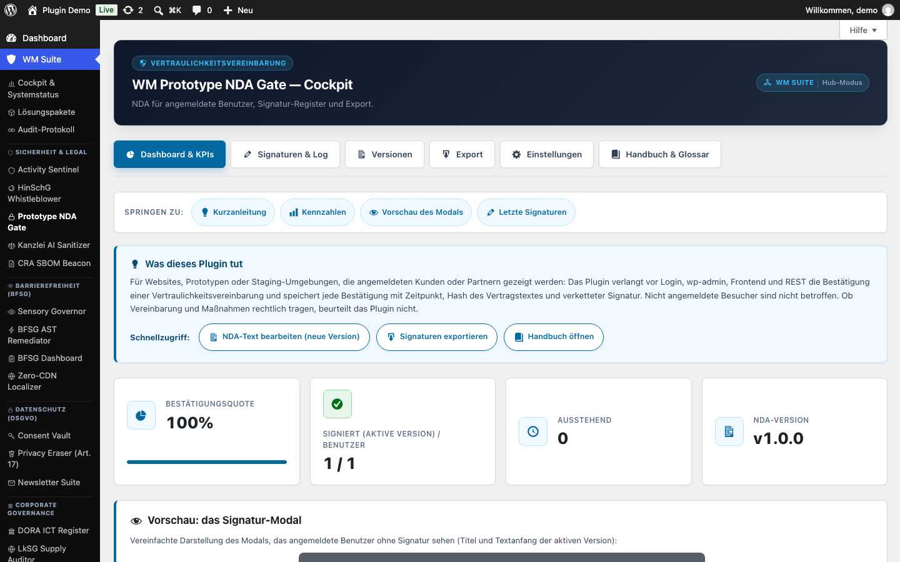
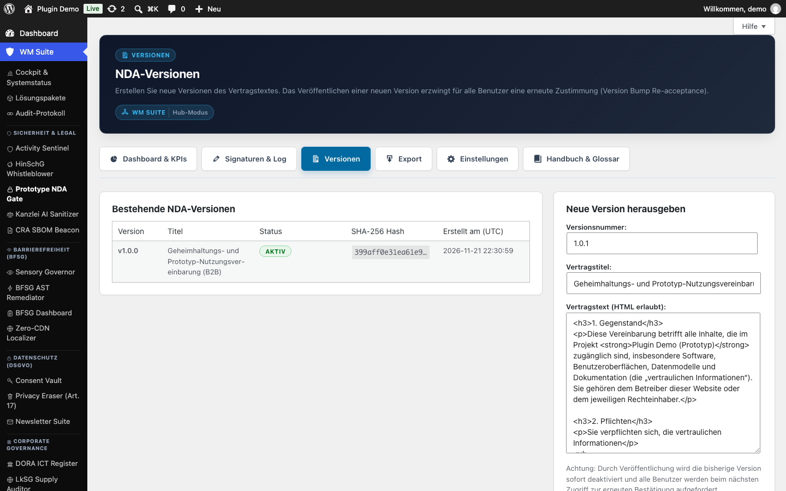
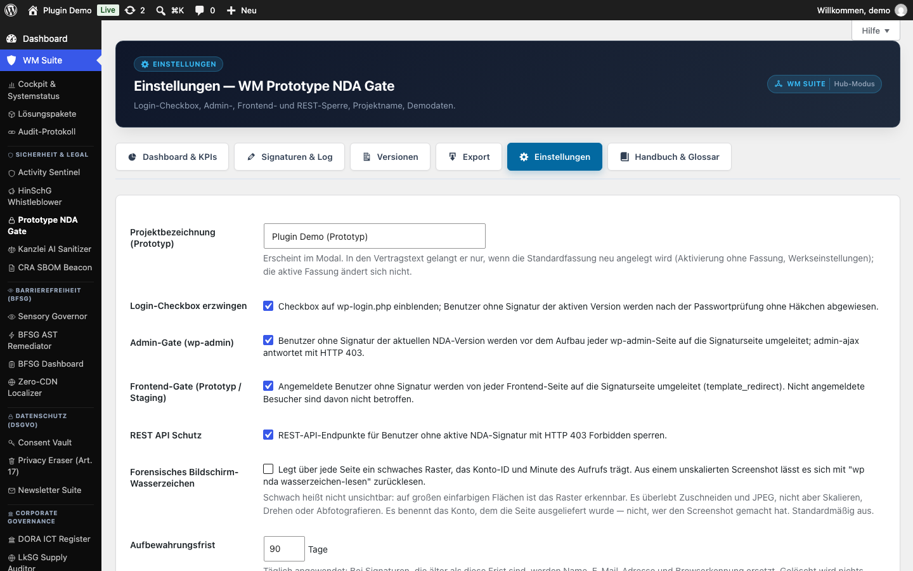
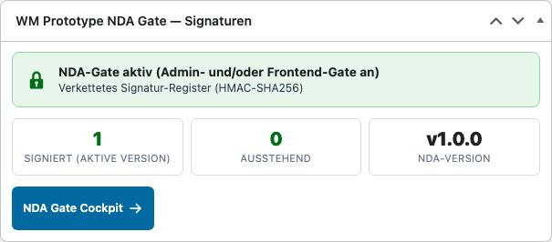

# WM Prototype NDA Gate (Documentación en Español)

<p align="center">
  <a href="README.md"></a>
  <a href="README.de.md"></a>
  <a href="README.es.md"></a>
</p>

> **Pide a los usuarios con sesión aceptar un acuerdo de confidencialidad antes de usar wp-login, wp-admin, el frontend o la API REST, y guarda cada aceptación en un registro encadenado con HMAC con exportación CSV y JSON — no evalúa jurídicamente el acuerdo**  
> **Página del plugin:** [https://arnoldwender.com/es/plugins-wordpress/wm-prototype-nda-gate/](https://arnoldwender.com/es/plugins-wordpress/wm-prototype-nda-gate/)  
> **Desarrollado con un agentic workflow:** creado con agentes de programación de IA. Revísalo y pruébalo como cualquier código de terceros antes de usarlo en producción.  
> **Soporte y responsabilidad:** Cero soporte (Zero Support) — errores reproducibles únicamente en [GitHub Issues](https://github.com/arnoldwender/wm-wp-prototype-nda-gate/issues) · sin soporte privado · TAL CUAL («AS IS») / sin responsabilidad ([SUPPORT.md](SUPPORT.md))

> Este archivo describe lo que el plugin entrega: los comandos WP-CLI `wp nda status|list|verify|demodaten|retention|wasserzeichen-lesen|wasserzeichen-probe`, las rutas REST `/accept`, `/verify`, `/register-integrity` y `/active-terms`, las tablas `wp_wm_nda_terms` y `wp_wm_nda_acceptances`, la acción `wm_nda_accepted`, Block Bindings de WP 6.5+ (`wm-nda/status`) y la etiqueta dinámica de GenerateBlocks (`{{wm_nda_status}}`). Ediciones anteriores describían componentes no entregados (sin shortcode, sin exportación PDF, sin libro GoBD) y hacían afirmaciones jurídicas que el software no puede decidir; el código y la documentación se auditaron y corrigieron juntos ([CHANGELOG.md](CHANGELOG.md)).

---

## Capturas en vivo

!Banner de WM Prototype NDA Gate

| Cockpit | Versiones NDA | Ajustes | Widget |
|---|---|---|---|
|  |  |  |  |

---

## Qué hace el plugin

1. **Casilla en el login.** En `wp-login.php`, una casilla de 24 × 24 px con el texto de aceptación y un botón que abre el texto completo. La comprobación corre en `authenticate` con prioridad 99, después de que WordPress verificó la contraseña: quien no aceptó la versión activa y no marcó la casilla es rechazado con una instrucción y se escribe un evento de auditoría `nda_bypass_attempt`; marcarla registra la aceptación, y si no se puede guardar, el login se rechaza. Quien ya aceptó entra sin marcarla. Los inicios de sesión con contraseña de aplicación no la piden. Solo `wp-login.php` muestra la casilla: los logins con `wp_login_form()`, formularios de temas o tiendas y XML-RPC rechazan a los usuarios sin aceptación con la misma instrucción, sin ofrecerla. Opción `wm_nda_require_login_checkbox`.
2. **Bloqueo en admin y frontend.** Para usuarios con sesión sin aceptación de la versión activa, `admin_init` (prioridad 1) redirige cada petición de wp-admin a `admin.php?page=wm-nda-gate`, una página sin entrada de menú (capacidad `read`) cuyo modal a pantalla completa cubre el menú de administración y los avisos que WordPress sigue imprimiendo debajo; `admin-ajax.php` responde HTTP 403 `wm_nda_required`. `template_redirect` (prioridad 0) manda las peticiones del frontend a la misma página. La URL pedida viaja codificada en `redirect_to`; tras aceptar en el modal, el usuario sigue ahí (solo mismo host). Opciones `wm_nda_enforce_admin_gate`, `wm_nda_enforce_frontend_gate`; filtro `wm_nda_gate_url` (una página del frontend a la que apunte no se redirige a sí misma, tiene que imprimir el modal y cargar sus recursos, y deja al usuario en ella después de aceptar). Los visitantes sin sesión, WP-CLI y cron no se bloquean.
3. **Bloqueo REST.** `rest_pre_dispatch` responde HTTP 403 `rest_forbidden` («Bitte bestätigen Sie zuerst die aktuelle Vertraulichkeitsvereinbarung (NDA).») a usuarios con sesión sin aceptación, salvo en rutas bajo `/wm-nda/v1/`, `/wp/v2/users/me` y `/wm-hub/v1/` (filtro `wm_nda_whitelisted_routes`). Opción `wm_nda_enforce_rest_api`.
4. **Registro.** Cada aceptación guarda ID de usuario, correo, nombre visible, el SHA-256 del texto, un HMAC de la IP con sal diaria, el user agent, la hora (UTC), la firma anterior y su propia firma (HMAC-SHA256 sobre firma anterior, ID de usuario, ID de versión, hash del texto, hora y hash de IP; clave `AUTH_KEY` o `wp_salt( 'auth' )`). Las escrituras corren bajo un bloqueo con nombre de MySQL, así que dos aceptaciones simultáneas no bifurcan la cadena. La firma más reciente y el número de filas se guardan en `wm_nda_register_tip`, sellados con un HMAC bajo la misma clave. Un usuario cuenta como firmado solo con una fila cuya firma verifica. `WM_NDA_Database::verify_register()` recalcula cada fila y detecta una aceptación alterada, borrada, insertada o recortada, y una punta de la cadena ausente, sin sello o reescrita, mientras la clave no se conozca; una punta sellada más antigua, copiada antes y restaurada, no se detecta. Cuando ninguna firma guardada coincide con la clave (un `AUTH_KEY` nuevo, una base de datos de otra instalación), lo dice. `wp nda verify`, `GET /wp-json/wm-nda/v1/register-integrity` (409 si falla) y la pantalla de firmas muestran el resultado. Los eventos de auditoría van a WM Activity Sentinel si está activo y, si no, al log de errores de PHP.
5. **Registro click-wrap.** Junto con la aceptación, el navegador informa qué observó mientras el acuerdo estuvo en pantalla: dispositivo de entrada (ratón, lápiz, táctil, teclado), cuánto tiempo estuvo abierto el diálogo, cuánto pasó entre marcar la casilla y confirmar, qué parte del texto se recorrió, cuántas muestras del puntero hubo y cuánto camino recorrió, el valor de presión más alto, el viewport y el desfase horario del dispositivo. Diez números enteros y dos enumeraciones, nada más: ni coordenadas ni series temporales. Lo que queda fuera de su rango se descarta, un registro de más de 2 048 bytes se descarta entero, y un registro ilegible nunca rechaza la aceptación. Lo que se guarda queda sellado: el SHA-256 del registro almacenado se añade a los datos firmados de su fila, así que editarlo, vaciarlo o inventarlo rompe la cadena desde ahí. Viene del navegador: demuestra que el diálogo fue operado, no por quién; un ratón no tiene sensor de presión, y las pantallas nombran su valor fijo 0,5 por lo que es. Las aceptaciones anteriores al 16/09/2026 y los navegadores sin JavaScript no llevan ninguno, y esas filas siguen verificando sin cambios.
6. **Marca de agua forense en pantalla.** Apagada por defecto (`wm_nda_watermark`). Encendida, cada página que ve un usuario firmante lleva un patrón tenue de celdas de 16 px: ochenta forman un bloque con palabra de sincronía, ID de cuenta, minuto de entrega y un HMAC de 20 bits bajo `AUTH_KEY`; el bloque se repite por el viewport, uno de cada dos invertido. `wp nda wasserzeichen-lesen <fichero>` lo vuelve a leer de una captura y nombra la cuenta, o responde «no encontrado» — decide el HMAC, así que nunca adivina. **Medido el 2026-09-16** (`tests/test-suite.php`, grupo 13, capturas sintéticas de una página con texto): se lee en 1440 × 900 y 2880 × 1800, en páginas oscuras, en páginas con imagen de portada en la mitad superior, en recortes hasta 800 × 640 aunque no estén alineados, y en JPEG hasta calidad 40 — y, medido con un navegador real contra la demo de una instalación local de WordPress, en la captura de una página WordPress de verdad. **No** se lee en una captura reescalada, en un recorte con un solo bloque ni sobre fondo muy fotográfico; ahí responde «no encontrado». Nombra la cuenta a la que se sirvió la página, no a quien hizo la captura, y cuesta contraste: gris #6e6e6e sobre blanco mide 5,10:1 y 4,49:1 con el patrón, así que el texto que estaba justo por encima del umbral WCAG cae por debajo.
7. **Versiones.** Publicar un texto nuevo lo guarda y solo después desactiva la versión anterior; todos los usuarios deben aceptar de nuevo. Un número de versión de más de 50 caracteres o un título de más de 255 se rechaza y la versión anterior sigue activa. El texto por defecto es un modelo en alemán sin revisión jurídica: no cita normas ni nombra a ningún proveedor y enumera lo que el registro guarda en cada aceptación.
8. **Administración.** Menú *WM NDA Gate* (posición 26) con cockpit (tasa de aceptación, usuarios firmados y pendientes, versión, firmas recientes, vista previa del modal), firmas con resultado de verificación, versiones, exportación (CSV con escape de inyección de fórmulas, JSON con la verificación del registro y una suma cuya receta viene en el archivo; ambas con todas las aceptaciones), ajustes con datos de demo y restablecimiento de fábrica, manual; widget del escritorio. Interfaz en alemán con las hojas de la familia de administración de WM Suite.
9. **REST y WP-CLI.** `POST /wp-json/wm-nda/v1/accept` (con sesión, 10 por minuto por IP), `GET /verify` (estado propio; el de otros solo para administradores; 60 por minuto por IP mediante `check_public_nda_access`, filtro `wm_nda_rest_rate_limit`), `GET /register-integrity` (administradores), `GET /active-terms` (público, 60 por minuto por IP). `wp nda status`, `wp nda list [--limit]`, `wp nda verify` (sale con error si el registro está roto), `wp nda demodaten --import|--delete|--reset [--yes]`, `wp nda retention [--dry-run]`, `wp nda wasserzeichen-lesen <fichero> [--porcelain]`, `wp nda wasserzeichen-probe [--user] [--datei] [--breite] [--hoehe]`.
10. **Herramientas de privacidad de WordPress.** Exportador y borrador de aceptaciones por correo, que encuentran la dirección guardada al firmar y la cuenta que tiene hoy esa dirección; el borrador seudonimiza nombre, correo y user agent, informa lo que conserva (ID de cuenta, firma, hora, versión, hash de IP — todo parte de los datos firmados) y borra los metadatos de la última aceptación de la cuenta.
11. **Spoke de WM Suite Hub.** Salud `ERROR` sin las tablas del plugin o cuando el registro no verifica, `NEEDS_CONFIG` sin versión activa, `DEGRADED` cuando todos los bloqueos están apagados, la clave viene de la base de datos o hay filas anteriores a la cadena, `HEALTHY` en otro caso; telemetría con tablas, versión, firmas, estado del registro, origen de la clave, destino de auditoría y opciones de bloqueo; acciones `self_test` y `purge_cache`.
12. **Block Bindings y GenerateBlocks.** Registra la fuente de Block Bindings `wm-nda/status` (`field`: `label`, `state`, `active_version`) desde WordPress 6.5 y la etiqueta dinámica `{{wm_nda_status}}` de GenerateBlocks 2.x (`key`: `label`, `state`, `active_version`), filtradas mediante `wm_nda_status_value`.

### No incluido

Ningún bloqueo para visitantes sin sesión (un sitio que deba seguir cerrado para ellos necesita su propio requisito de login); ningún shortcode ni bloque propio (el estado dinámico se expone mediante Block Bindings `wm-nda/status` y GenerateBlocks `{{wm_nda_status}}`); ninguna exportación PDF; ningún borrado de aceptaciones al vencer el plazo de conservación — desde el 2026-09-17 una pasada diaria seudonimiza nombre, correo y user agent de las aceptaciones más antiguas y deja la fila (`wp nda retention`, detalle en [README.md](README.md#what-the-retention-pass-does)); ninguna notificación por correo, roles exentos ni listas de IP permitidas; ninguna firma electrónica en el sentido de eIDAS, solo un clic registrado; ninguna identificación biométrica — el registro click-wrap cuenta cómo se operó el diálogo y no distingue a una persona de otra; ninguna evaluación de si el acuerdo o las medidas cumplen GeschGehG, UrhG o DSGVO.

---

## Inicio rápido

1. Instala y activa el plugin (WordPress 6.4+, PHP 8.2+). La activación crea las tablas y la versión 1.0.0 del acuerdo por defecto.
2. Lee el texto por defecto en **WM NDA Gate › Versionen** y publica tu propia versión; hazla revisar antes de usarla en serio.
3. En **Einstellungen** revisa los cuatro bloqueos y pon el nombre del proyecto.
4. Inicia sesión con una cuenta de prueba que aún no aceptó: sin marcar la casilla el login se rechaza; al marcarla, la aceptación aparece en **Signaturen & Log**.
5. Ejecuta `wp nda verify` o abre **Signaturen & Log** para ver la verificación del registro.

Clases, rutas, hooks, opciones y desviaciones conocidas: **[README.md](README.md)** (referencia), **[DEVELOPERS.md](DEVELOPERS.md)** y [docs/DEVELOPER-GUIDE.md](docs/DEVELOPER-GUIDE.md).

```bash
php tests/test-suite.php        # registro, bloqueos, exportaciones, privacidad, adaptador, datos de demo, tokens, catálogos, documentos
bash tests/run-mutations.sh     # cada corrección se deshace una vez; la suite tiene que ponerse en rojo
wp eval-file wp-content/plugins/wm-prototype-nda-gate/tests/wp-runtime-nda.php --user=1   # dentro de WordPress; no escribe nada
tests/runtime/verify-gate-http.sh   # 19 comprobaciones HTTP contra un WordPress local (crea y borra un usuario de prueba)
```

### Problemas conocidos

- El texto del acuerdo por defecto es un modelo sin revisión jurídica. Desde la 1.3.3, ni él ni el aviso del modal, la casilla o el botón de aceptar citan normas ni afirman un efecto vinculante; antes de usarlo en serio, publica tu propia versión revisada en **Versionen**.
- Los datos de demo solo se importan en un registro sin firmas reales y solo se borran mientras ninguna firma real esté encadenada con ellos; el restablecimiento de fábrica borra todo.
- `tests/test-nda-interception.php` y `test-register-integrity.php` vacían el registro y `test-nda-privacy-tools.php` escribe y borra una fila de prueba; ejecútalos solo en una instalación desechable de WordPress.
- La verificación lee todas las filas en cada llamada; la pantalla de firmas y el hub la ejecutan en cada vista.
- Un `AUTH_KEY` nuevo, o una base de datos copiada de otra instalación, deja todas las firmas guardadas sin posibilidad de verificación; nada las vuelve a firmar, y esos usuarios aceptan de nuevo.
- Las filas anteriores a la cadena (antes del 2026-08-27) ya no cuentan como aceptación.
- En SQLite (WordPress Playground, wp-now) las escrituras del registro no se serializan.
- La página de firma solo cubre el menú de administración; su HTML lo sigue conteniendo, igual que los avisos de otros plugins.
- El indicador «pendientes» cuenta a todo usuario registrado sin aceptación, también a los que nunca inician sesión.
- La marca de agua es tenue, no invisible: sobre superficies planas grandes el patrón se distingue. Sobrevive al recorte y al JPEG, no al reescalado, al giro ni a fotografiar la pantalla, y cuesta el contraste medido arriba. Viene apagada.
- El registro click-wrap es lo que informó el navegador. Cambiarlo después rompe la cadena; que fuera cierto al enviarse no lo comprueba nada.

---

## Datos y límites

- **Lo que el plugin establece:** que una cuenta con sesión marcó o aceptó una versión concreta del texto en un momento dado, guardado con una firma encadenada que revela cambios posteriores hechos sin la clave. No decide si el acuerdo es válido, si las medidas son razonables según el § 2 GeschGehG ni qué valor probatorio tiene el registro.
- **Peticiones salientes:** ninguna.
- **Datos personales:** por aceptación, ID de usuario, correo, nombre visible, user agent, el registro click-wrap (dispositivo de entrada, duraciones, recorrido del puntero, viewport, desfase horario — los dos últimos describen el dispositivo usado), hora y un HMAC de la IP con sal diaria, en dos tablas de la base de datos del sitio; las herramientas de privacidad de WordPress los exportan y seudonimizan, y la pasada diaria de conservación seudonimiza nombre, correo y user agent cuando una aceptación supera `wm_nda_retention_days` (por defecto 90; por debajo de 30 no cambia nada). Los eventos de auditoría (ID de usuario, nombre de acceso, HMAC de la IP) van a WM Activity Sentinel o al log de errores de PHP, que ni las herramientas de privacidad ni la desinstalación tocan. Desinstalar conserva por defecto tablas, opciones y metadatos de usuario salvo que se active `wm_nda_delete_data_on_uninstall`.
- **Campo por campo:** [docs/DATA-PROCESSING.md](docs/DATA-PROCESSING.md) (en alemán) enumera qué se guarda dónde y qué cambian las herramientas de privacidad y la pasada de conservación. No nombra ninguna base jurídica: cuál aplica y qué deberes de información se siguen lo decide quien opera el sitio.

---

## Licencia

Distribuido bajo licencia **GNU General Public License v2 o posterior**.  
Copyright (C) 2026 Arnold Wender.  
