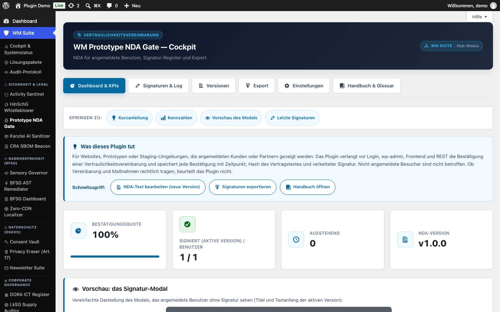
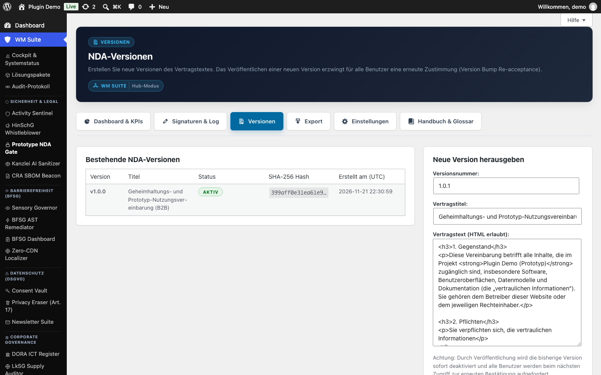
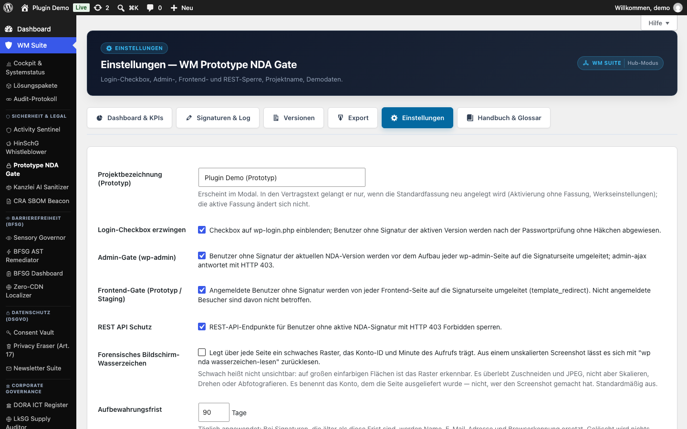
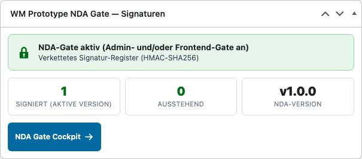

# WM Prototype NDA Gate

<p align="center">
  <a href="README.md"></a>
  <a href="README.de.md"></a>
  <a href="README.es.md"></a>
  <a href="#translated-documentation"></a>
</p>

<p align="center">
  <a href="https://wordpress.org"></a>
  <a href="https://php.net"></a>
  <a href="LICENSE"></a>
</p>

> **Asks logged-in users to accept a confidentiality agreement before they use wp-login, wp-admin, the frontend or the REST API, and keeps every acceptance in an HMAC-chained register with CSV and JSON export — it makes no legal assessment of the agreement**  
> **Plugin page:** [https://arnoldwender.com/wordpress-plugins/wm-prototype-nda-gate/](https://arnoldwender.com/wordpress-plugins/wm-prototype-nda-gate/)  
> **Built with an agentic workflow:** developed with AI coding agents. Review and test it like any third-party code before you use it in production.  
> **Support & Liability:** Zero support — reproducible bugs on [GitHub Issues](https://github.com/arnoldwender/wm-wp-prototype-nda-gate/issues) only · no private support · AS IS / no liability ([SUPPORT.md](SUPPORT.md))

> This README describes what the plugin ships: WP-CLI commands `wp nda status|list|verify|demodaten|retention|wasserzeichen-lesen|wasserzeichen-probe`, REST routes `/accept`, `/verify`, `/register-integrity` and `/active-terms`, the tables `wp_wm_nda_terms` and `wp_wm_nda_acceptances`, the `wm_nda_accepted` action, WP 6.5+ Block Bindings (`wm-nda/status`), and the GenerateBlocks dynamic tag (`{{wm_nda_status}}`). Earlier revisions documented unshipped components (no frontend shortcode, no PDF writer, no GoBD ledger) and stated legal assessments that software cannot make; code and documentation were audited and aligned together ([CHANGELOG.md](CHANGELOG.md)).

---

## Showcase

!WM Prototype NDA Gate banner

No marketing mockup from `assets/images/` is embedded (`assets/images/` remains excluded via `.distignore`); the banner above and the live WordPress screenshots below live in `.wordpress-org/`.

| Cockpit | NDA Versions | Settings | Dashboard Widget |
|---|---|---|---|
|  |  |  |  |

---

## What the plugin does

1. **Login checkbox.** On `wp-login.php` a 24 × 24 px checkbox with the agreement label and a button that opens the full text. The check runs on `authenticate` at priority 99, after WordPress has verified the password: a user who has not accepted the active version and did not tick the box is refused with an instruction and a `nda_bypass_attempt` audit event; ticking records the acceptance, and a login whose acceptance cannot be stored is refused. Users who already accepted log in without ticking. Application-password logins are not asked. Only `wp-login.php` shows the box: logins through `wp_login_form()`, theme or shop forms and XML-RPC refuse unsigned users with the same instruction without offering it. Option `wm_nda_require_login_checkbox`.
2. **Admin and frontend gate.** For logged-in users without an acceptance of the active version: `admin_init` (priority 1) redirects every wp-admin request to `admin.php?page=wm-nda-gate`, a page without menu entry (capability `read`) whose full-screen modal covers the admin menu and notices WordPress still prints under it, and `admin-ajax.php` answers HTTP 403 `wm_nda_required`; `template_redirect` (priority 0) sends frontend requests to the same page. The requested URL travels along encoded in `redirect_to`; after accepting through the modal the user continues there (same host only). Options `wm_nda_enforce_admin_gate`, `wm_nda_enforce_frontend_gate`; filter `wm_nda_gate_url` (a frontend page it points at is not redirected to itself, has to print the modal and load its assets, and keeps the user after signing). Anonymous visitors, WP-CLI and cron are not gated.
3. **REST lock.** `rest_pre_dispatch` answers HTTP 403 `rest_forbidden` ("Bitte bestätigen Sie zuerst die aktuelle Vertraulichkeitsvereinbarung (NDA).") to logged-in users without an acceptance, except routes under `/wm-nda/v1/`, `/wp/v2/users/me` and `/wm-hub/v1/` (filter `wm_nda_whitelisted_routes`). Option `wm_nda_enforce_rest_api`.
4. **Register.** Each acceptance stores user ID, e-mail, display name, the SHA-256 of the agreement text, an HMAC of the IP address with a daily salt, the user agent, the time (UTC), the previous signature and its own signature (HMAC-SHA256 over previous signature, user ID, term ID, text hash, time and IP hash, key `AUTH_KEY` or `wp_salt( 'auth' )`). Writes run under a MySQL named lock, so simultaneous acceptances cannot fork the chain. The newest signature and the row count are kept in `wm_nda_register_tip`, sealed with an HMAC under the same key. A user counts as signed only with a row whose signature checks out. `WM_NDA_Database::verify_register()` recomputes every row and reports an altered, removed, inserted or cut-off acceptance and a missing, unsealed or rewritten tip, as long as the key is not known; an older sealed tip that was copied beforehand and put back is not noticed. When no stored signature matches the key (a new `AUTH_KEY`, a database from another installation) it says so. `wp nda verify`, `GET /wp-json/wm-nda/v1/register-integrity` (409 when broken) and the signatures screen show the result. Audit events go to WM Activity Sentinel when it is active, otherwise to the PHP error log.
5. **Click-wrap record.** With the acceptance the browser reports what it observed while the agreement was on screen: input device (mouse, pen, touch, keyboard), how long the dialog was open, how long between ticking the box and confirming, how far the text was scrolled, how many pointer samples and how much travel, the highest pressure value, the viewport and the device's offset from UTC. Ten whole numbers and two enumerations, nothing else — no coordinates, no timing series. Everything outside its range is dropped, the whole record above 2 048 bytes is dropped, and a record that cannot be read never refuses the acceptance. What is kept is sealed: the SHA-256 of the stored record is appended to the signed payload of its row, so editing, blanking or inventing one breaks the chain from there on. It comes from the browser, so it shows that the dialog was operated, not by whom; a mouse has no pressure sensor and the screens name its constant 0.5 for what it is. Acceptances recorded before 2026-09-16 and browsers without JavaScript carry none, and those rows keep verifying unchanged.
6. **Forensic screen watermark.** Off by default (`wm_nda_watermark`). Switched on, every page a signed user sees carries a faint pattern of 16 px cells: eighty of them make a block holding a sync word, the account ID, the minute the page was served and a 20-bit HMAC under `AUTH_KEY`, and the block repeats across the viewport with every second one inverted. `wp nda wasserzeichen-lesen <datei>` reads it back out of a screenshot and names the account, or says "not found" — the HMAC decides, so it never guesses one. **Measured on 2026-09-16** (`tests/test-suite.php` group 13, synthetic screenshots of a page of text): read back from 1440 × 900 and 2880 × 1800 screenshots, from dark pages, from pages whose top half is a hero image, from crops down to 800 × 640 whether or not they are aligned to the grid, and from JPEG down to quality 40 — and, measured with a real browser against the local demo home page, from a screenshot of an actual WordPress page. **Not** read back from a screenshot that was scaled, from one holding a single block, or from a strongly photographic background; those answer "not found". It names the account the page was served to, not who took the screenshot, and the pattern costs contrast: grey #6e6e6e on white measures 5.10:1 and 4.49:1 under the overlay, so text that sat just above the WCAG threshold falls below it.
7. **Versions.** Publishing a new text stores it and then deactivates the previous version; every user has to accept again. A version number over 50 characters or a title over 255 is refused, and the previous version stays active. The default text is a German sample agreement without legal review: it cites no statute, names no vendor and lists what the register stores for each acceptance.
8. **Admin.** Menu *WM NDA Gate* (position 26) with cockpit (acceptance rate, signed users, pending users, version, recent signatures, modal preview), signatures with verification result, versions, export (CSV with formula-injection escaping, JSON with the register check and a checksum whose recipe the file states; both with every acceptance), settings with demo data and factory reset, handbook; dashboard widget. German interface on the WM Suite admin family sheets.
9. **REST and WP-CLI.** `POST /wp-json/wm-nda/v1/accept` (logged in, 10 per minute per IP), `GET /verify` (own status; others only for administrators; 60 per minute per IP via `check_public_nda_access`, filter `wm_nda_rest_rate_limit`), `GET /register-integrity` (administrators), `GET /active-terms` (public, 60 per minute per IP via `check_public_nda_access`). `wp nda status`, `wp nda list [--limit]`, `wp nda verify` (error exit when broken), `wp nda demodaten --import|--delete|--reset [--yes]`, `wp nda retention [--dry-run]`, `wp nda wasserzeichen-lesen <datei> [--porcelain]`, `wp nda wasserzeichen-probe [--user] [--datei] [--breite] [--hoehe]`.
10. **WordPress privacy tools.** Exporter and eraser for acceptances by e-mail, matching the address stored at signing and the account that holds the address now; the eraser pseudonymises name, e-mail and user agent, reports what it keeps (account ID, signature, time, version, IP hash — all part of the signed payload) and removes the account's last-acceptance meta.
11. **WM Suite Hub spoke.** Health `ERROR` without the plugin's tables or when the register does not verify, `NEEDS_CONFIG` without an active version, `DEGRADED` when every gate is off, the key comes from the database or pre-chain rows exist, `HEALTHY` otherwise; telemetry with tables, version, signatures, register state, key source, audit sink and gate options; actions `self_test` and `purge_cache`.
12. **Block Bindings and GenerateBlocks.** Registers the WordPress 6.5+ Block Bindings source `wm-nda/status` (`field` argument: `label`, `state`, `active_version`) and the GenerateBlocks 2.x dynamic tag `{{wm_nda_status}}` (`key` option: `label`, `state`, `active_version`), filtered through `wm_nda_status_value`.

### Not shipped

No gate for anonymous visitors (a site that must stay closed to them needs a login requirement of its own); no shortcode or standalone block (dynamic status is exposed via Block Bindings `wm-nda/status` and GenerateBlocks `{{wm_nda_status}}`); no PDF export; no deletion of acceptances after the retention window — the daily retention pass pseudonymises name, e-mail and user agent and keeps the row ([below](#what-the-retention-pass-does)); no e-mail notifications, bypass roles or IP allow-lists; no electronic signature in the sense of eIDAS, only a recorded click; no biometric identification — the click-wrap record counts how the dialog was operated and cannot tell one person from another; no assessment of whether the agreement or the measures satisfy GeschGehG, UrhG or DSGVO.

---

## Quick start

1. Install and activate the plugin (WordPress 6.4+, PHP 8.2+). Activation creates the tables and version 1.0.0 of the default agreement.
2. Read the default text under **WM NDA Gate › Versionen** and publish your own version; have it reviewed before real use.
3. Under **Einstellungen** check the four gates and set the project name.
4. Log in with a test account that has not accepted yet: without ticking the checkbox the login is refused; after ticking it the acceptance appears under **Signaturen & Log**.
5. Run `wp nda verify` or open **Signaturen & Log** to see the register check.

---

## Settings and stored state

Set on **WM NDA Gate › Einstellungen**, or with `wp option update`:

| Option | Default | What it does |
|---|---|---|
| `wm_nda_project_name` | the site title plus ` (Prototyp)` | the name shown in the modal, on the login screen, in `wp nda status` and in every export. It is the only piece of operator text the plugin composes, so it is what a signatory sees they agreed to |
| `wm_nda_retention_days` | `90` | applied nightly — see below |
| `wm_nda_delete_data_on_uninstall` | `0` | opt-in data removal on plugin deletion; while `0` (default), `uninstall.php` leaves options, user meta and both NDA tables intact |
| `wm_nda_schema_version` | `WM_NDA_Database::SCHEMA_VERSION` (`4`) | bookkeeping: compared on load, and the tables are brought forward when it is behind. Lowering it by hand re-runs the upgrade |

The four gate switches (login, wp-admin, frontend, REST) and `wm_nda_register_tip` are documented in [DEVELOPERS.md](DEVELOPERS.md). **Never write the tip by hand** — an unsealed tip does not verify.

### What the retention pass does

Applied daily since 2026-09-17. Signatures older than the window lose `user_name`, `user_email`
and `user_agent`. The click-wrap record stays with the row, like `ip_hmac` below: its SHA-256 is
part of the signed payload.

```bash
wp nda retention --dry-run    # what a pass would change
wp nda retention              # run it now; the daily event does the same
```

**Nothing is deleted, and nothing is re-signed.** The register is a hash chain whose whole value
is that a recorded acceptance cannot be removed — deleting a row breaks verification for every row
after it. The pass removes the directly identifying fields and keeps what the signature covers.
Whether that is enough for a given site is the operator's assessment; the plugin makes no legal
claim about it.

**`ip_hmac` is never touched.** It is part of the signed payload
(`WM_NDA_Database::generate_signature_hash()`), so rewriting it makes the register report that row
as tampered — the defect the privacy eraser carried until 2026-09-14. It is already a day-salted
pseudonym.

| Behaviour | Value |
|---|---|
| Below 30 (the form's minimum) | keep everything — the daily event is unscheduled |
| 30 – 3650 | applied nightly |
| Rows per pass | at most 500; the rest wait for the next run |

Unlike the Activity Sentinel's log, no residual fingerprints are needed here: this register's
signature covers `prev_hash|user_id|term_id|term_hash|timestamp|ip_hmac[|evidence_hash]` and **not**
the name, the address or the user agent, so every signature keeps recomputing exactly as before.

---

## Developers

Classes, routes, hooks, options and the hub adapter: **[DEVELOPERS.md](DEVELOPERS.md)**; the interception flow in detail: [docs/DEVELOPER-GUIDE.md](docs/DEVELOPER-GUIDE.md).

```bash
php tests/test-suite.php        # register, gates, exports, privacy tools, adapter, demo data, tokens, catalogs, documents
bash tests/run-mutations.sh     # every correction undone once; the suite must turn red
php tests/watermark-envelope.php --check   # where the watermark reads back and where it does not
wp eval-file wp-content/plugins/wm-prototype-nda-gate/tests/wp-runtime-nda.php --user=1   # inside WordPress; writes nothing
tests/runtime/verify-gate-http.sh   # 19 HTTP checks against a local WordPress (creates and deletes a probe user)
```

### Known issues

- The default agreement text is a sample without legal review. Since 1.3.3 it, the modal notice, the checkbox and the accept button cite no statute and claim no binding effect; publish your own reviewed text under **Versionen** before real use.
- Demo data can only be imported into a register without real signatures and only be deleted while no real signature is chained with it; the factory reset deletes everything.
- `tests/test-nda-interception.php` and `test-register-integrity.php` empty the register and `test-nda-privacy-tools.php` writes and deletes a probe row; run them only on a disposable WordPress instance.
- Verification reads every row on each call; the signatures screen and the hub run it on every view.
- A new `AUTH_KEY`, or a database copied from another installation, leaves every stored signature unverifiable; nothing re-signs them, and those users accept again.
- Rows written before the chain existed (before 2026-08-27) no longer count as an acceptance.
- On SQLite (WordPress Playground, wp-now) writes to the register are not serialised.
- The gate page covers the admin screen instead of leaving it out; its HTML still contains the admin menu and other plugins' notices.
- The KPI "pending" counts every registered user without an acceptance, including users who never log in.
- The screen watermark is faint, not invisible: on a large flat area the grid can be made out. It survives cropping and JPEG but not scaling, rotation or a photograph of the screen, and it costs the contrast measured above. It is off until switched on.
- The click-wrap record is what the browser reported. Nothing can change it afterwards without breaking the chain, and nothing checks whether it was true when it was sent.

---

## Translated documentation

Translated READMEs live in `docs/translations/README.<lang>.md`; their headings are translated and their bodies carry the English text of this file.

**UI catalogs (`languages/`):** 28 `.po` / `.mo` locale catalogs covering all 261 entries of `wm-prototype-nda-gate.pot` (`ar`, `bg_BG`, `cs_CZ`, `da_DK`, `de_DE`, `el`, `en_GB`, `en_US`, `es_ES`, `et`, `fi`, `fi_FI`, `fr_FR`, `ga`, `hr_HR`, `hu_HU`, `it_IT`, `lt_LT`, `lv`, `mt_MT`, `nl_NL`, `pl_PL`, `pt_PT`, `ro_RO`, `sk_SK`, `sl_SI`, `sv_SE`, `tr_TR`).

| Language (Native) | Catalog | Language (Native) | Catalog |
|---|---|---|---|
| [Български](docs/translations/README.bg.md) | `bg_BG` | [Magyar](docs/translations/README.hu.md) | `hu_HU` |
| [Čeština](docs/translations/README.cs.md) | `cs_CZ` | [Italiano](docs/translations/README.it.md) | `it_IT` |
| [Dansk](docs/translations/README.da.md) | `da_DK` | [Lietuvių](docs/translations/README.lt.md) | `lt_LT` |
| [Deutsch](README.de.md) | `de_DE` | [Latviešu](docs/translations/README.lv.md) | `lv` |
| [Ελληνικά](docs/translations/README.el.md) | `el` | [Malti](docs/translations/README.mt.md) | `mt_MT` |
| [English](README.md) | `en_GB`, `en_US` | [Nederlands](docs/translations/README.nl.md) | `nl_NL` |
| [Español](README.es.md) | `es_ES` | [Polski](docs/translations/README.pl.md) | `pl_PL` |
| [Eesti](docs/translations/README.et.md) | `et` | [Português](docs/translations/README.pt.md) | `pt_PT` |
| [Suomi](docs/translations/README.fi.md) | `fi`, `fi_FI` | [Română](docs/translations/README.ro.md) | `ro_RO` |
| [Français](docs/translations/README.fr.md) | `fr_FR` | [Slovenčina](docs/translations/README.sk.md) | `sk_SK` |
| [Gaeilge](docs/translations/README.ga.md) | `ga` | [Slovenščina](docs/translations/README.sl.md) | `sl_SI` |
| [Hrvatski](docs/translations/README.hr.md) | `hr_HR` | [Svenska](docs/translations/README.sv.md) | `sv_SE` |

---

## Data and limits

- **What the plugin establishes:** that a logged-in account ticked or clicked an acceptance of a given text version at a given time, recorded with a chained signature that reveals later changes made without the key. It does not decide whether the agreement is valid, whether the measures count as reasonable under GeschGehG § 2, or which evidential weight the register has.
- **Outbound requests:** none.
- **Screen watermark:** nothing new is stored. The pattern is computed per request and carries the account ID and the minute in the pixels of the screen; the browser is handed the finished bits, never the account, the minute or the key.
- **Personal data:** per acceptance the user ID, e-mail, display name, user agent, the click-wrap record (input device, durations, pointer travel, viewport, offset from UTC — the last two describe the device used), time and a daily-salted HMAC of the IP address, in two tables of the site's database; the WordPress privacy tools export and pseudonymise them, and the daily retention pass pseudonymises name, e-mail and user agent once an acceptance is older than `wm_nda_retention_days` (default 90; below 30 nothing is changed). Audit events (user ID, login name, IP HMAC) go to WM Activity Sentinel or the PHP error log, which neither the privacy tools nor the uninstaller touch. Uninstalling preserves the tables, options and user meta by default unless `wm_nda_delete_data_on_uninstall` is enabled under **Einstellungen**.
- **Field by field:** [docs/DATA-PROCESSING.md](docs/DATA-PROCESSING.md) (German) lists what is stored where and what the privacy tools and the retention pass change. It names no legal basis: which one applies, and which information duties follow, is for the site operator to decide.

---

## Contribution & Security

- [CONTRIBUTING.md](CONTRIBUTING.md) · [SECURITY.md](SECURITY.md) · [CHANGELOG.md](CHANGELOG.md)

---

## License

Distributed under the **GNU General Public License v2 or later**.  
Copyright (C) 2026 Arnold Wender.  
