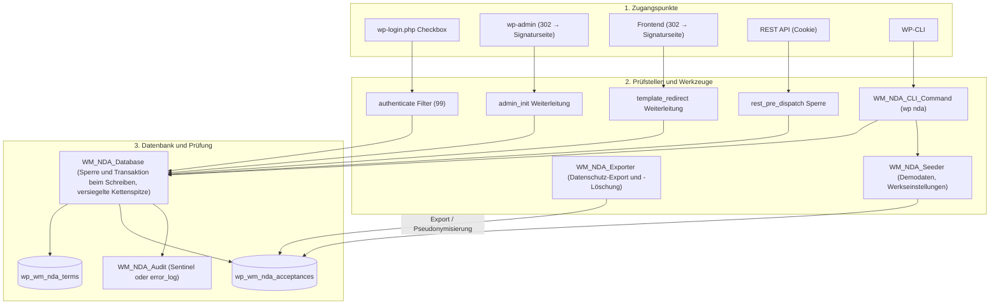

# System- und Sicherheitsarchitektur — WM Prototype NDA Gate

> Technische Beschreibung, gemessen am Code. Frühere Fassungen beschrieben nicht ausgelieferte Klassen (`WM_NDA_Gate_*`) oder externe Synchronisation; Referenz auf Englisch: [DEVELOPERS.md](../DEVELOPERS.md).

---

## 1. Systemübersicht

Das Plugin verlangt von **angemeldeten** Benutzern die Bestätigung der aktiven Vertraulichkeitsvereinbarung an vier Stellen und speichert jede Bestätigung in einem verketteten Register mit versiegelter Kettenspitze. Nicht angemeldete Besucher, WP-CLI und Cron sind nicht betroffen. Ob Vereinbarung und Maßnahmen rechtlich tragen, beurteilt das Plugin nicht.

```
                  ┌────────────────────────────────────────┐
                  │   Anfrage eines angemeldeten Benutzers │
                  └───────────────────┬────────────────────┘
                                      │
       ┌──────────────────┬───────────┴──────┬──────────────────┐
       ▼                  ▼                  ▼                  ▼
┌──────────────┐  ┌──────────────┐  ┌──────────────┐  ┌──────────────┐
│ wp-login.php │  │   wp-admin   │  │   Frontend   │  │   REST API   │
│ authenticate │  │  admin_init  │  │ template_red.│  │ rest_pre_disp│
│  (Prio. 99)  │  │  (Prio. 1)   │  │  (Prio. 0)   │  │  (Prio. 5)   │
└──────┬───────┘  └──────┬───────┘  └──────┬───────┘  └──────┬───────┘
       └─────────────────┴────────┬────────┴─────────────────┘
                                  ▼
                 ┌─────────────────────────────────┐
                 │        WM_NDA_Database          │
                 │ wp_wm_nda_terms · acceptances   │
                 └────────────────┬────────────────┘
                                  ▼
                 ┌─────────────────────────────────┐
                 │ WM_NDA_Audit: WM Activity       │
                 │ Sentinel, sonst PHP error_log   │
                 └─────────────────────────────────┘
```

---

## 2. Datenbank

### Tabelle `wp_wm_nda_terms`
Fassungen des Vertragstextes:
* `term_id`: BIGINT UNSIGNED (Primärschlüssel)
* `term_version`: VARCHAR(50)
* `term_title`: VARCHAR(255)
* `term_content`: LONGTEXT
* `term_hash`: VARCHAR(64) — SHA-256 des gespeicherten Textes
* `is_active`: TINYINT(1)
* `created_at`: DATETIME (UTC)
* `created_by`: BIGINT UNSIGNED

### Tabelle `wp_wm_nda_acceptances`
Verkettetes Register der Bestätigungen. Jede Zeile signiert ihre Vorgängerin mit; das Ende der Kette steht zusätzlich in der Option `wm_nda_register_tip`, versiegelt mit demselben Schlüssel; Schreibvorgänge laufen unter einer MySQL-Namenssperre, und `wp nda verify` rechnet jede Signatur gegen ihre Zeile nach. Damit fällt eine geänderte, gelöschte oder eingeschleuste Bestätigung auf und ebenso eine veränderte oder gelöschte Kettenspitze, solange der Schlüssel nicht bekannt ist; eine vorher kopierte ältere Kettenspitze, die zurückgespielt wird, fällt nicht auf. Welche Beweiskraft das in einem Verfahren hat, entscheidet nicht dieses Plugin:
* `acceptance_id`: BIGINT UNSIGNED (Primärschlüssel)
* `user_id`: BIGINT UNSIGNED (0 für Demodaten ohne Konto)
* `term_id`: BIGINT UNSIGNED
* `user_email`: VARCHAR(100)
* `user_name`: VARCHAR(100) — längere Anzeigenamen werden gekürzt gespeichert
* `term_hash_at_signing`: VARCHAR(64)
* `ip_hmac`: VARCHAR(64) — HMAC der IP-Adresse mit täglich wechselndem Salt
* `user_agent`: TEXT
* `interaction_json`: TEXT — kanonischer Click-Wrap-Nachweis des Browsers (zehn ganze Zahlen, zwei Aufzählungen, Schlüssel sortiert) oder leer
* `accepted_at`: DATETIME (UTC)
* `prev_hash`: VARCHAR(64) — Signatur der Vorgängerin
* `signature_hash`: VARCHAR(64) — HMAC-SHA256 über `prev_hash | user_id | term_id | term_hash | accepted_at | ip_hmac` mit `AUTH_KEY` (ohne ihn oder mit dem Platzhalter aus wp-config-sample.php `wp_salt( 'auth' )`). Trägt die Zeile einen Click-Wrap-Nachweis, wird `| sha256( interaction_json )` angehängt; ist er leer, wird nichts angehängt — deshalb verifizieren alle vor Schema 4 geschriebenen Zeilen unverändert weiter. Der Fingerabdruck wird bei jeder Prüfung aus der Spalte neu berechnet und nicht daneben gespeichert: ein zweiter Wert ließe sich stehen lassen, während der Nachweis umgeschrieben wird

---

## 3. Prüfstellen

1. **`authenticate` Filter (Priorität 99):**
   * Läuft nach der Passwortprüfung des Kerns (Priorität 20) und vor der Ausstellung von Session-Cookies: nur gültige Zugangsdaten erreichen die NDA-Prüfung.
   * Benutzer ohne Signatur der aktiven Fassung brauchen die Checkbox `wm_nda_accept=1`; wer schon signiert hat, meldet sich ohne sie an. Im Browser ist die Checkbox nicht `required`. Lässt sich die Bestätigung nicht speichern, wird die Anmeldung abgewiesen.
   * Nur `wp-login.php` zeigt die Checkbox; Anmeldungen über `wp_login_form()`, Theme- oder Shop-Formulare und XML-RPC werden für Benutzer ohne Signatur abgewiesen, ohne dass sie angeboten wird.
   * Anmeldungen per Anwendungspasswort werden nicht nach der Checkbox gefragt. Bis 2026-09-14 hing die Prüfung an `wp_authenticate_user`, das WordPress vor dem Passwortvergleich anwendet: ein falsches Passwort mit angehakter Checkbox speicherte eine Signatur.
2. **`admin_init` Hook (Priorität 1):**
   * Läuft auf allen `wp-admin` Unterseiten, bevor eine davon aufgebaut wird.
   * Prüft gegen den Object-Cache und die Datenbank, ob der angemeldete Benutzer die aktive `term_id` mit einer gültigen Signatur bestätigt hat.
   * Bei fehlender Signatur: `HTTP 302` auf `admin.php?page=wm-nda-gate`, die angefragte Adresse kodiert in `redirect_to`. Die Seite hat keinen Menüeintrag und die Capability `read`; das nicht-schließbare Modal überdeckt das Admin-Menü und die Hinweise, die WordPress darunter weiterhin ausgibt. `admin-ajax.php` antwortet mit `HTTP 403` (`wm_nda_required`).
3. **`template_redirect` Hook (Priorität 0):**
   * Angemeldete Benutzer ohne Signatur werden von jeder Frontend-Seite auf die Signaturseite umgeleitet, bevor das Theme etwas ausgibt (`wm_nda_enforce_frontend_gate`). Eine Frontend-Seite, auf die der Filter `wm_nda_gate_url` zeigt, wird nicht auf sich selbst umgeleitet.
4. **`rest_pre_dispatch` Filter (Priorität 5):**
   * Antwortet angemeldeten Benutzern ohne Signatur mit `HTTP 403` (`rest_forbidden`, „Bitte bestätigen Sie zuerst die aktuelle Vertraulichkeitsvereinbarung (NDA).“); ausgenommen sind `/wm-nda/v1/`, `/wp/v2/users/me` und `/wm-hub/v1/` (Filter `wm_nda_whitelisted_routes`). Anonyme Anfragen passieren diesen Filter.

---

## 4. Neue Fassung (Version Bump)

Wird im Backend eine neue Fassung veröffentlicht:
1. Versionsnummer (höchstens 50 Zeichen), Titel (höchstens 255) und Text werden geprüft; sonst bleibt alles, wie es ist, und der Bildschirm meldet das.
2. Eine gleiche Fassung (Version und Hash) wird gesucht, sonst wird eine neue Zeile inaktiv angelegt.
3. Erst danach schaltet eine Anweisung diese Fassung an und alle anderen ab.
4. Transient `wm_nda_active_term` und Cache-Gruppe `wm_nda_gate` werden geleert.
5. Weil die neue Fassung eine neue `term_id` hat, gilt für jeden Benutzer beim nächsten Aufruf: noch nicht bestätigt.

---

## 5. Komponenten



---

## 6. Click-Wrap-Nachweis

`WM_NDA_Evidence` nimmt entgegen, was der Browser beim Bestätigen meldet, und lässt nur durch, was in der Positivliste steht: zehn ganze Zahlen mit geschlossenen Wertebereichen (`move_samples`, `path_px`, `pressure_max_permille`, `pressure_samples`, `dwell_ms`, `check_to_accept_ms`, `scroll_pct`, `viewport_w`, `viewport_h`, `tz_offset_min`) und zwei Aufzählungen (`pointer_type`, `accept_input`). Werte außerhalb ihres Bereichs werden verworfen statt begrenzt — eine begrenzte Zahl sähe aus wie eine Messung und wäre keine. Eingaben über 2 048 Byte werden gar nicht erst geparst, die Schemanummer setzt der Server. Gespeichert wird ausschließlich Ganzzahliges: eine Fließkommazahl würde je nach `serialize_precision` anders kodiert, und dieselbe Zeile ließe sich auf einem anderen Server nicht mehr verifizieren; der Druckwert reist deshalb als Promille.

Zwei Transportwege: die REST-Route `/accept` nimmt ihn im Feld `interaction` entgegen — bewusst ohne Schematyp, damit ein fehlerhafter Nachweis nicht die Bestätigung selbst mit HTTP 400 abweist —, und `wp-login.php` trägt ihn im versteckten Feld `wm_nda_interaction`, weil dieser Weg die Bestätigung in PHP schreibt und die REST-Route nie aufruft. In beiden Fällen gilt: kein lesbarer Nachweis, trotzdem gespeicherte Bestätigung.

Was er zeigt: dass der Dialog bedient wurde. Was er nicht zeigt: von wem — das sagt das angemeldete Konto. Eine Maus hat keinen Drucksensor und meldet nach der Pointer-Events-Spezifikation konstant 0,5, solange eine Taste gedrückt ist; die Oberfläche nennt diesen Festwert beim Namen, statt ihn als halben Druck auszugeben.

---

## 7. Forensisches Bildschirm-Wasserzeichen

Standardmäßig aus (`wm_nda_watermark`). Eingeschaltet legt `WM_NDA_Watermark::render_overlay()` in `wp_footer` und `admin_footer` ein Element über die Seite, das den fertigen Bitblock trägt; `assets/js/nda-watermark.js` malt ihn auf ein Canvas über dem Sichtfenster.

**Block (80 Bit, zeilenweise über 10 × 8 Zellen zu 16 px):** 8 Bit Synchronisationswort `0xB2`, 4 Bit Version, 24 Bit Konto-ID, 24 Bit Minuten seit dem 1.1.2026, 20 Bit HMAC-SHA256 über die drei Felder mit dem Kettenschlüssel. Der Browser bekommt nur die Hexadezimaldarstellung: weder Konto noch Minute noch Schlüssel verlassen den Server in lesbarer Form.

**Modulation:** 3 % Deckung, Schwarz für eine Eins, Weiß für eine Null. Gleiche Deckung, entgegengesetzte Farbe — so bleibt der Abstand zwischen Eins und Null auf hellem wie auf dunklem Untergrund etwa gleich. Jeder zweite Block wird invertiert (`(bx + by) % 2`); das ist es, was der Leser ausnutzt, um den Seiteninhalt herauszurechnen.

**Leser (`extract_from_file()`):** findet das Zellraster über die Gradientenenergie je Spalte und je Zeile, probiert für drei Gerätemaßstäbe alle achtzig Blockphasen, summiert je Block die Abweichung jeder Zelle vom Blockmittel mit dem Vorzeichen des Trägers und **gewichtet nach dem Kehrwert der Varianz dieses Blocks** — ein Block über einem Hero-Bild schwankt um hundert Helligkeitsstufen, das Muster um sieben —, sortiert die Ausrichtungen nach Synchronübereinstimmung mal Stärke und dekodiert die besten 24. Entschieden wird über den HMAC — ein Bild ohne Wasserzeichen bekommt „nicht gefunden“, nie eine Konto-ID.

**Gemessene Grenzen (2026-09-16):** lesbar aus 1440 × 900 und 2880 × 1800, von dunklen Seiten, von Seiten mit Hero-Bild, aus unausgerichteten Ausschnitten bis 800 × 640, aus JPEG bis Qualität 40, über starkem Rauschen und aus dem Screenshot einer echten WordPress-Seite (mit einem Browser gegen die lokale WordPress-Installation-Demo gemessen). Nicht lesbar: skalierte Screenshots, Ausschnitte mit einem einzigen Block, stark fotografischer Untergrund. Das Wasserzeichen benennt das Konto, dem die Seite ausgeliefert wurde — nicht, wer den Screenshot gemacht hat.

**Preis in Kontrast:** Grau #6e6e6e auf Weiß misst 5,10:1, unter dem Raster 4,49:1. Text knapp über der WCAG-Schwelle fällt darunter; `tests/test-suite.php` hält diese Zahl fest.

---

## 8. Sprachen und Datenschutz

* **Sprachkataloge:** `languages/` enthält die Vorlage (`wm-prototype-nda-gate.pot`, 261 Einträge) und 28 vollständig übersetzte `.po`/`.mo`-Kataloge.
* **IP-Adressen:** Das Register speichert je Bestätigung einen HMAC der Adresse mit täglich wechselndem Salt. Die Anfragebegrenzungen von `/accept` (10/Min.) sowie `/verify` und `/active-terms` (60/Min., Filter `wm_nda_rest_rate_limit`) verwenden die ersten 32 Zeichen desselben HMAC im Namen eines Transients (`wm_nda_rl_*` bzw. `wm_nda_rl_pub_*`). Audit-Ereignisse tragen den IP-HMAC ebenfalls und gehen an WM Activity Sentinel oder das PHP-Fehlerprotokoll.

---

<!-- wm-measured-inventory -->

## Measured inventory

Regenerated from the code, never hand-edited. Everything above this line is written by hand and stays.

```bash
python3 the fleet's architecture inventory tool wm-prototype-nda-gate --append-to docs/ARCHITECTURE.md
```

## Inventory by layer

**17 PHP files, 6247 lines** (excluding `tests/`, `vendor/`, `node_modules/`, `languages/`).

| Layer | Files | Lines |
|---|---:|---:|
| `(raíz)` | 2 | 325 |
| `includes` | 15 | 5922 |

---

## Classes

| Class | File |
|---|---|
| `WM_NDA_Admin` | [`includes/class-nda-admin.php`](../includes/class-nda-admin.php) |
| `WM_NDA_Audit` | [`includes/class-nda-audit.php`](../includes/class-nda-audit.php) |
| `WM_NDA_CLI_Command` | [`includes/class-nda-cli.php`](../includes/class-nda-cli.php) |
| `WM_NDA_Core` | [`includes/class-nda-core.php`](../includes/class-nda-core.php) |
| `WM_NDA_Database` | [`includes/class-nda-database.php`](../includes/class-nda-database.php) |
| `WM_NDA_Evidence` | [`includes/class-nda-evidence.php`](../includes/class-nda-evidence.php) |
| `WM_NDA_Exporter` | [`includes/class-nda-exporter.php`](../includes/class-nda-exporter.php) |
| `WM_NDA_I18n` | [`includes/class-nda-i18n.php`](../includes/class-nda-i18n.php) |
| `WM_NDA_Interceptor` | [`includes/class-nda-interceptor.php`](../includes/class-nda-interceptor.php) |
| `WM_NDA_Modal` | [`includes/class-nda-modal.php`](../includes/class-nda-modal.php) |
| `WM_NDA_REST_API` | [`includes/class-nda-rest-api.php`](../includes/class-nda-rest-api.php) |
| `WM_NDA_Retention` | [`includes/class-nda-retention.php`](../includes/class-nda-retention.php) |
| `WM_NDA_Seeder` | [`includes/class-nda-seeder.php`](../includes/class-nda-seeder.php) |
| `WM_NDA_Spoke_Adapter` | [`includes/class-nda-spoke-adapter.php`](../includes/class-nda-spoke-adapter.php) |
| `WM_NDA_Watermark` | [`includes/class-nda-watermark.php`](../includes/class-nda-watermark.php) |

---

## Entry points

**REST routes:** `/accept`, `/active-terms`, `/register-integrity`, `/verify`

**WP-CLI:** `nda`

---

## Persistence — who writes each key and who reads it

| Key | Written by | Read by |
|---|---|---|
| `wm_nda_active_term` (transient) | — | — |
| `wm_nda_delete_data_on_uninstall` | `includes/class-nda-admin.php`, `includes/class-nda-seeder.php`, `wm-prototype-nda-gate.php` | `includes/class-nda-admin.php`, `uninstall.php`, `wm-prototype-nda-gate.php` |
| `wm_nda_enforce_admin_gate` | `includes/class-nda-admin.php`, `includes/class-nda-seeder.php`, `wm-prototype-nda-gate.php` | `includes/class-nda-admin.php`, `includes/class-nda-interceptor.php`, `includes/class-nda-spoke-adapter.php`, `wm-prototype-nda-gate.php` |
| `wm_nda_enforce_frontend_gate` | `includes/class-nda-admin.php`, `includes/class-nda-seeder.php`, `wm-prototype-nda-gate.php` | `includes/class-nda-admin.php`, `includes/class-nda-interceptor.php`, `includes/class-nda-spoke-adapter.php`, `wm-prototype-nda-gate.php` |
| `wm_nda_enforce_rest_api` | `includes/class-nda-admin.php`, `includes/class-nda-seeder.php`, `wm-prototype-nda-gate.php` | `includes/class-nda-admin.php`, `includes/class-nda-interceptor.php`, `includes/class-nda-spoke-adapter.php`, `wm-prototype-nda-gate.php` |
| `wm_nda_last_accepted_at` (user meta) | — | — |
| `wm_nda_last_accepted_term_id` (user meta) | — | — |
| `wm_nda_project_name` | `includes/class-nda-admin.php`, `wm-prototype-nda-gate.php` | `includes/class-nda-admin.php`, `includes/class-nda-cli.php`, `includes/class-nda-core.php`, `includes/class-nda-exporter.php`, `includes/class-nda-i18n.php`, `includes/class-nda-modal.php`, `wm-prototype-nda-gate.php` |
| `wm_nda_require_login_checkbox` | `includes/class-nda-admin.php`, `includes/class-nda-seeder.php`, `wm-prototype-nda-gate.php` | `includes/class-nda-admin.php`, `includes/class-nda-interceptor.php`, `includes/class-nda-spoke-adapter.php`, `wm-prototype-nda-gate.php` |
| `wm_nda_retention_days` | `includes/class-nda-admin.php`, `includes/class-nda-seeder.php`, `wm-prototype-nda-gate.php` | `includes/class-nda-admin.php`, `includes/class-nda-retention.php`, `wm-prototype-nda-gate.php` |
| `wm_nda_schema_version` | `wm-prototype-nda-gate.php` | `wm-prototype-nda-gate.php` |

**More than one writer:** `wm_nda_delete_data_on_uninstall`, `wm_nda_enforce_admin_gate`, `wm_nda_enforce_frontend_gate`, `wm_nda_enforce_rest_api`, `wm_nda_project_name`, `wm_nda_require_login_checkbox`, `wm_nda_retention_days`. Two layers writing one key is the shape that goes out of sync; check they agree on the default as well as on the value.


**Tables** (prefixed with `$wpdb->prefix`): `wm_nda_acceptances`, `wm_nda_terms`

---

## Gates

- `tests/mutations.php`
- `tests/run-mutations.sh`
- `tests/test-audit-fallback.php`
- `tests/test-i18n.php`
- `tests/test-nda-interception.php`
- `tests/test-nda-privacy-tools.php`
- `tests/test-nda-security.php`
- `tests/test-pot-freshness.php`
- `tests/test-register-integrity.php`
- `tests/test-suite.php`
- `tests/test-ui-family.php`
- `tests/watermark-envelope.php`
- `tests/wp-runtime-nda.php`
- `.github/workflows/ci.yml`

What CI actually runs is in the workflow files above — a test file that no workflow invokes is not a gate.

---

## Drift detected against the documentation

Nothing measurable: versions agree and every class named in the documents exists.

